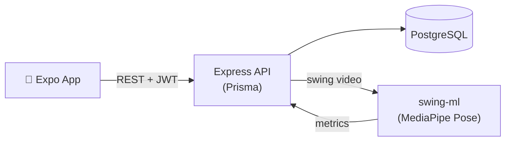

<div align="center">


[](https://github.com/milkamilch)

</div>

```bash
lars@dortmund:~$ neofetch
```

<div align="center">



</div>

```bash
lars@dortmund:~$ cat about.md
```

> 💼 **Backend Developer at Zolitron** — tour planning for waste collection: Java · Spring Boot · OR-Tools<br>
> 🎓 **M.Sc. Business Informatics** (Wirtschaftsinformatik), in progress · B.Sc. 2026 ✔<br>
> 🧠 Into optimization problems, backends that don't page you at 3 a.m., and homelabs<br>
> 🌍 Dortmund, Germany

```text
lars@dortmund:~$ // ──────────────────────────────────────────────
```

```bash
lars@dortmund:~$ ls -l ~/projects
```

| | Project | What it does | Stack |
|---|---|---|---|
| 🎓 | **[ztp-ki-framework](https://github.com/milkamilch/ztp-ki-framework)** | My B.Sc. thesis: zero-touch provisioning for bare-metal servers that detects failures live and heals itself (retry / reboot / rollback). Research question: from how many servers on does it pay off for SMEs? | `Python` `Isolation Forest` `Redfish` `Ansible` |
| 🐳 | **[env-buddy](https://github.com/milkamilch/env-buddy)** | Self-service dashboard for on-demand Docker test environments — start, stop, snapshot, share with the team | `FastAPI` `React` `Docker` |
| 🧩 | **[PersonalOs](https://github.com/milkamilch/PersonalOs)** | Self-hosted productivity PWA — habits, goals, journal, finance, plus a Claude-powered assistant with RAG over my own docs | `Spring Boot` `React` `RAG` |
| ⛳ | **[FairwayIQ](https://github.com/milkamilch/FairwayIQ)** | Golf app with AI swing analysis via pose estimation, round & handicap tracking | `Expo` `Prisma` `MediaPipe` |
| ➗ | **[Kalkulix](https://github.com/milkamilch/Kalkulix)** | Real-time 1v1 math duels with ELO, streaks and quests — QuizDuel, but the questions fight back | `Expo` `Fastify` `tRPC` `Socket.io` |
| 💪 | **[TrainingsApp](https://github.com/milkamilch/TrainingsApp)** | iOS workout tracker that writes the plan and bumps the weights for you | `SwiftUI` `SwiftData` |
| 📺 | **[iptv-player](https://github.com/milkamilch/iptv-player)** | Lightweight desktop IPTV player — Xtream Codes / M3U, EPG, HLS · [download](https://github.com/milkamilch/iptv-player/releases/latest) | `Electron` `React` |

```bash
lars@dortmund:~$ cat FairwayIQ/architecture.md
```



```text
lars@dortmund:~$ // ──────────────────────────────────────────────
```

```bash
lars@dortmund:~$ ls tech_stack/
```


```text
lars@dortmund:~$ // ──────────────────────────────────────────────
```

```bash
lars@dortmund:~$ cat ~/.todo
```

```diff
+ [x] B.Sc. Business Informatics
+ [x] Get a job where my routes end up in real trucks
! [ ] M.Sc. Business Informatics          # compiling…
! [ ] Lower my golf handicap              # FairwayIQ is on it
- [ ] Understand JavaScript               # wontfix
```

```bash
lars@dortmund:~$ ps aux | grep lars
```

```
PID   COMMAND
1337  🎮 gaming
1338  🤾 handball
1339  🖥️  homelab
1340  ⛳ golf
1341  📚 studying (nice -n 19)
```

<div align="center">

[](https://git.io/streak-stats)

<picture>
  <source media="(prefers-color-scheme: dark)" srcset="https://raw.githubusercontent.com/milkamilch/milkamilch/output/github-contribution-grid-snake-dark.svg" />
  <source media="(prefers-color-scheme: light)" srcset="https://raw.githubusercontent.com/milkamilch/milkamilch/output/github-contribution-grid-snake.svg" />
  
</picture>


</div>
